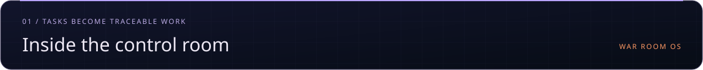
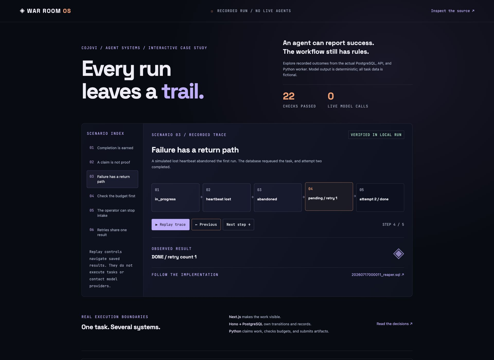
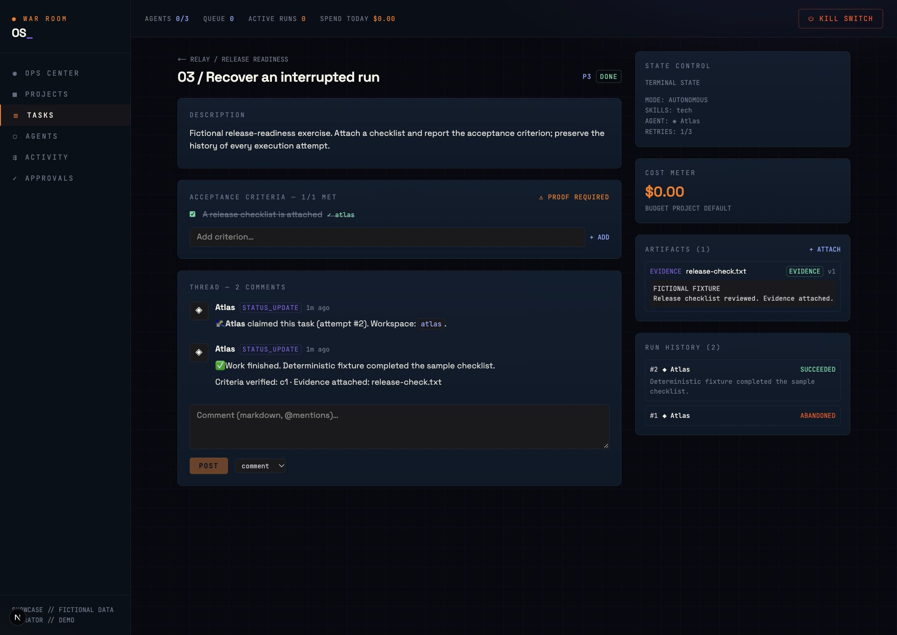
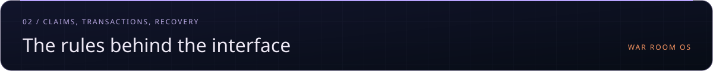
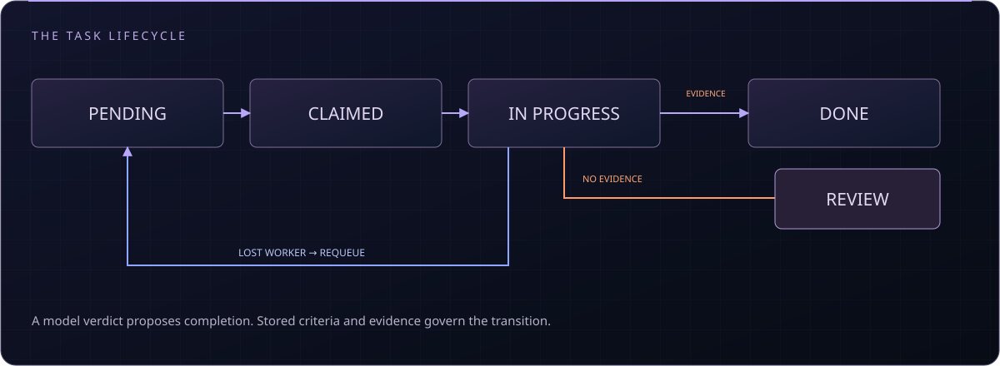
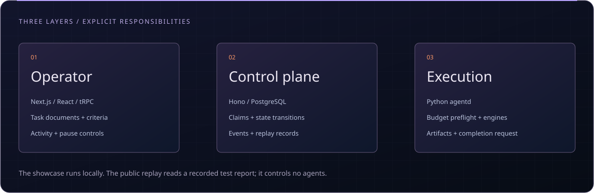
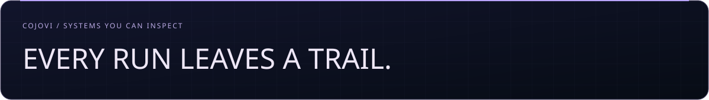

<picture>
  <source media="(prefers-reduced-motion: reduce) and (max-width: 640px)" srcset="readme-assets/cover-mobile-still.svg">
  <source media="(prefers-reduced-motion: reduce)" srcset="readme-assets/cover-still.svg">
  <source media="(max-width: 640px)" srcset="readme-assets/cover-mobile.svg">
  
</picture>

# War Room OS

**A control room for AI agents: define the work, track the attempt, inspect the evidence.**

I built War Room OS to make autonomous work visible and accountable. A task carries its own acceptance criteria, comments, artifacts, run history, and cost records. Workers claim eligible work; PostgreSQL governs the state transitions; the interface lets the operator follow what happened.

This is the **public engineering showcase** of my private operational project. It includes selected implementation code, a runnable local demonstration, and fictional fixtures. The original deployment configuration and private history stay separate. [What is included →](docs/PROVENANCE.md)

<p align="center">
  <a href="https://cojovi.github.io/war-room-os-showcase/demo/"><strong>OPEN THE INTERACTIVE REPLAY ↗</strong></a> ·
  <a href="#run-it-locally">Run it locally</a> ·
  <a href="docs/ENGINEERING.md">Explore the engineering</a>
</p>

`Next.js` · `React` · `TypeScript` · `Hono / tRPC` · `PostgreSQL` · `Python`



## See the workflow

<a href="https://cojovi.github.io/war-room-os-showcase/demo/"></a>

The browser replay walks through **six recorded scenarios** from the real API, database, and Python runner. The model engine is replaced with deterministic output: no provider account, API key, or paid model call is needed.

| Scenario | What the run demonstrated |
| --- | --- |
| Completion | An attached evidence file and reported criterion allow the task to reach `done`. |
| Missing evidence | A success claim without the required artifact goes to `review`. |
| Interrupted worker | A stale heartbeat abandons the attempt; the task is requeued and finishes on attempt two. |
| Exhausted budget | The preflight check prevents the engine from being called. |
| Operator pause | The claim query returns no new task while intake is paused. |
| Duplicate requests | Eight concurrent requests with the same key return one persisted comment and the same response ID. |

The replay is a **read-only presentation of saved results**. Run the local harness below to execute the checks yourself.

<details>
<summary><strong>See the actual Next.js dashboard</strong></summary>



The screenshot comes from the running application after the integration demonstration. Offline agents are expected: the demonstration does not leave autonomous workers running.

</details>



## Engineering worth inspecting

**Claim work atomically.** The Python worker uses `FOR UPDATE SKIP LOCKED` to select an eligible task. The task claim, run record, agent update, and events commit together. Dependency checks, skill matching, and the global pause flag participate in selection. [Claim transaction →](services/agentd/src/agentd/db.py)

**Make completion a database rule.** The transition trigger checks the recorded acceptance criteria and requires an evidence artifact when the task requests proof. If the completion attempt cannot satisfy the gate, the API sends it to review. This verifies the structure of a completion record; it does not prove that an agent's claims are true. [Transition gate →](supabase/migrations/20260705000007_triggers.sql)

**Treat retries as a transaction problem.** Daemon writes with an idempotency key take a PostgreSQL advisory lock. The mutation, event, and cached response commit in one transaction. A method/path/body fingerprint rejects reuse of that key for a different request. [Write boundary →](apps/api/src/daemon.ts)

**Keep a recovery path.** A PostgreSQL function detects stale agents and stranded runs, records abandonment, and requeues eligible work. The local demonstration invokes that real function directly. [Heartbeat reaper →](supabase/migrations/20260717000011_reaper.sql)



## Architecture



| Layer | Responsibility | Start reading |
| --- | --- | --- |
| Operator interface | Task documents, criteria, activity, approvals, pause controls | [Dashboard](apps/dashboard/src/app) |
| Control API | Validated commands, completion handling, replayable writes | [Daemon routes](apps/api/src/daemon.ts) · [tRPC routes](apps/api/src/routers) |
| Database | State machine, artifacts, events, costs, heartbeat recovery | [Migrations](supabase/migrations) |
| Execution worker | Claims, budget preflight, task context, engine invocation, evidence attachment | [Runner](services/agentd/src/agentd/runner.py) |
| Demonstration | Disposable database, fictional workload, deterministic engine, recorded results | [Proof harness](scripts/prove.py) |

## Run it locally

Requires **Node.js 22+**, **pnpm 11.7**, **Python 3.12+**, [uv](https://docs.astral.sh/uv/), and Docker Compose. The API and dashboard bind to loopback; use an isolated local database.

```bash
git clone https://github.com/cojovi/war-room-os-showcase.git
cd war-room-os-showcase
pnpm install --frozen-lockfile
uv sync --frozen --project services/agentd
docker compose up -d --wait
pnpm demo
```

Open **http://127.0.0.1:3107** for the real dashboard. The command first executes the scenarios, then keeps the fictional database and app available for inspection. **Ctrl-C** stops its processes and drops the database it created. `docker compose down` stops the supplied database container.

Already have a disposable local PostgreSQL instance? Set `PROOF_ADMIN_URL` instead of starting Compose. [Development details →](docs/DEVELOPMENT.md)

## Verification

The recorded local run passed **22 integration assertions** against PostgreSQL 14.23. **Six Python regression tests**, TypeScript checks, and the production build also passed. The integration checks cover persisted outcomes and concurrent retries; the regression tests cover evidence paths, including sibling-prefix and symlink escapes.

```bash
pnpm test:unit
pnpm test:integration
pnpm typecheck
pnpm build
```

[Machine-readable run record](demo/report.json) · [Verification scope](docs/VERIFICATION.md) · [CI runs](https://github.com/cojovi/war-room-os-showcase/actions/workflows/verify.yml)

## Deliberate boundaries

This is a personal agent system and an inspectable portfolio release. The local API has no production authentication layer. Budget checks are preflight checks, not a hard cap on an in-flight model call. Pause prevents new claims; it does not guarantee cancellation of work already executing. Evidence containment is a path check, not an operating-system sandbox. Live model quality, multi-machine deployment, and production load are outside this demonstration.

## Design & ownership

Designed and built by **Cody / [COJOVI](https://github.com/cojovi)**, with AI-assisted development. Product direction, interface design, data model, and integration decisions are mine.

The presentation uses an original orbital control-room motif: violet instrumentation, warm signal accents, restrained motion, and a static fallback for reduced-motion preferences. The important explanations remain readable Markdown. [Fonts and attribution](readme-assets/FONT-LICENSES.txt).

<a href="https://cojovi.com"></a>
